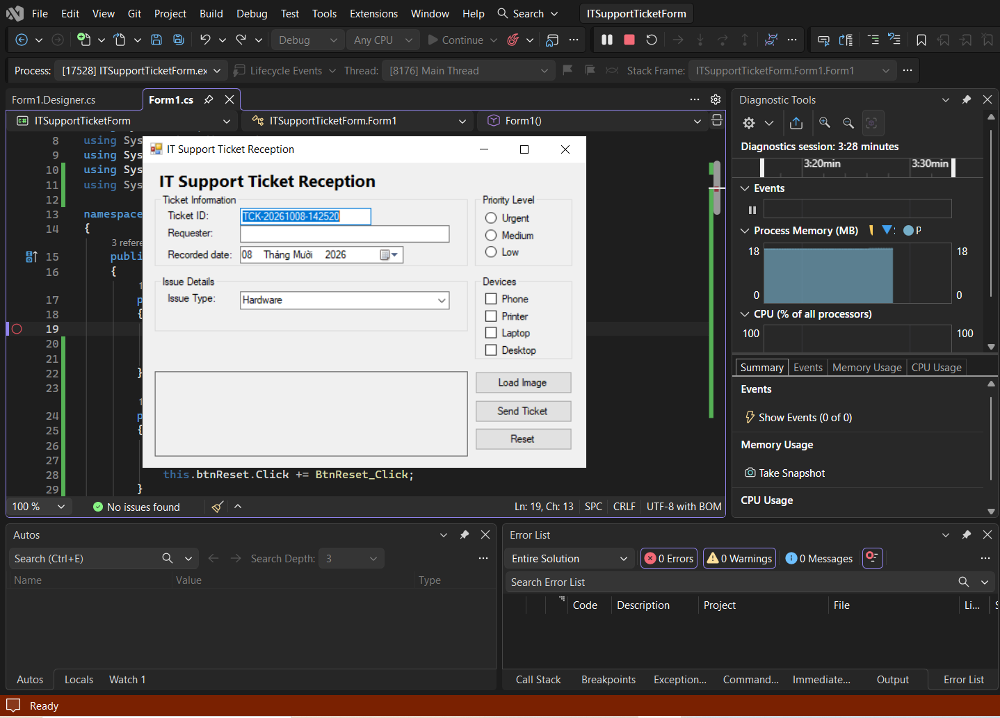
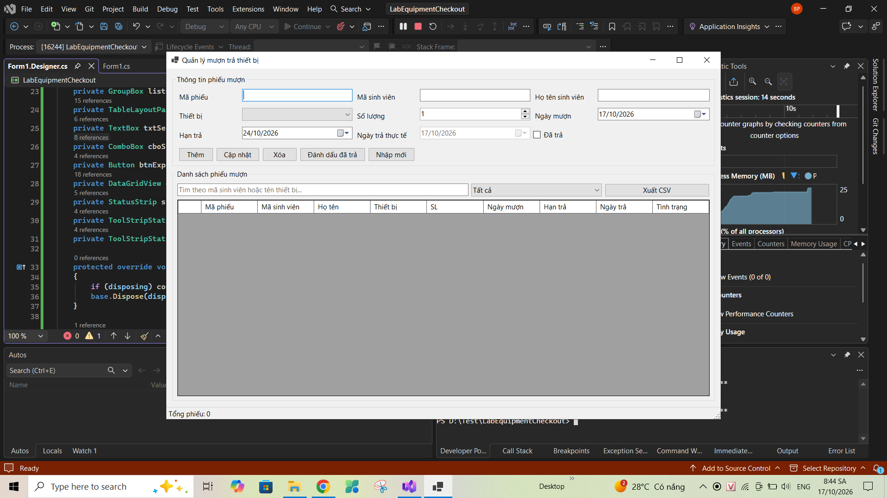
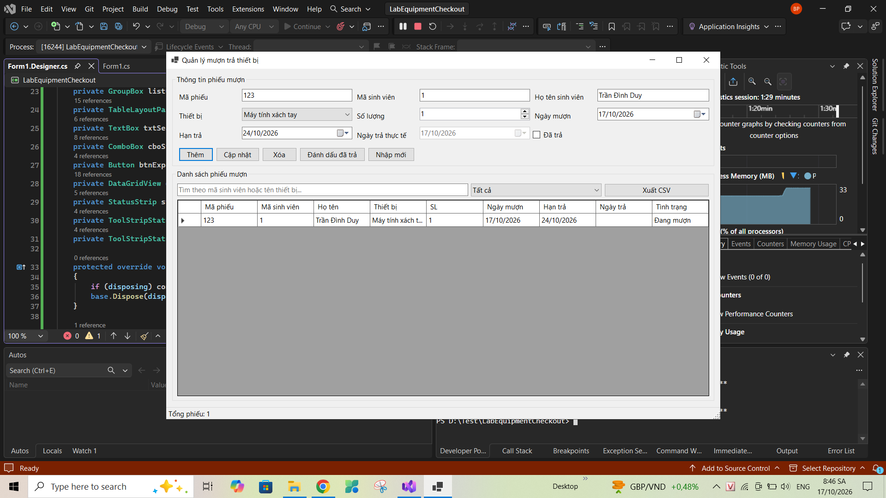
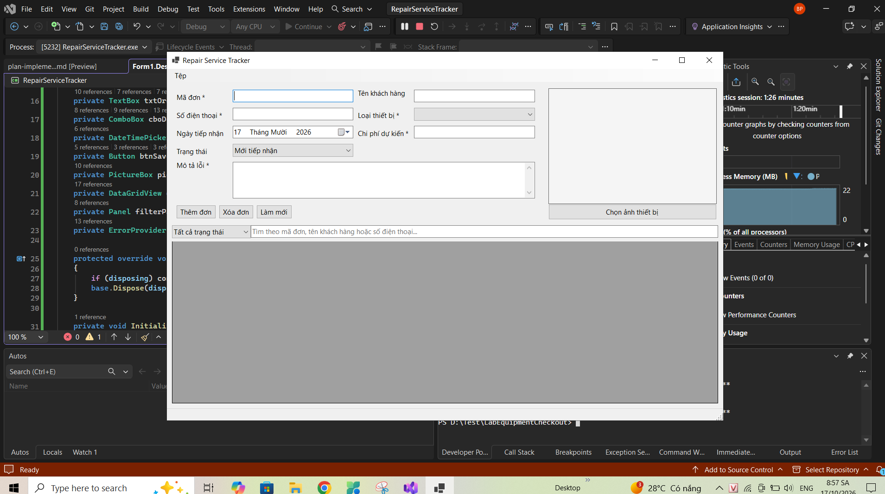
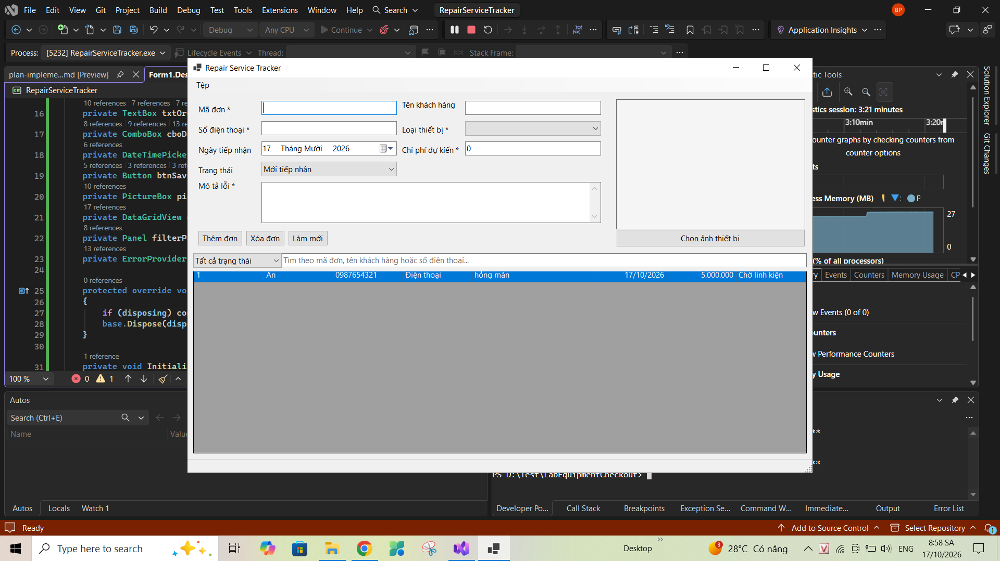

# BÁO CÁO BÀI TẬP / ĐỒ ÁN

## THÔNG TIN SINH VIÊN
- **Họ và tên:** Phạm Gia Bảo
- **Mã số sinh viên:** 24810320309
- **Lớp:** D19ATTT
- **Tên môn học:** Lập trình C# / Windows Forms
- **Tên bài tập:** Bài tập 4.9, 4.10, 4.11

---
## KẾT QUẢ THỰC HÀNH

### 1. Bài 4.9: IT Support Ticket Form
- **Giao diện chính:**
  

### 2. Bài 4.10: Lab Equipment Checkout
- **Giao diện chính:**
  
- **Kết quả thực thi / Kiểm tra lỗi:**
  

### 3. Bài 4.11: Repair Service Tracker
- **Giao diện chính:**
  
- **Kết quả thực thi / Kiểm tra lỗi:**
  
